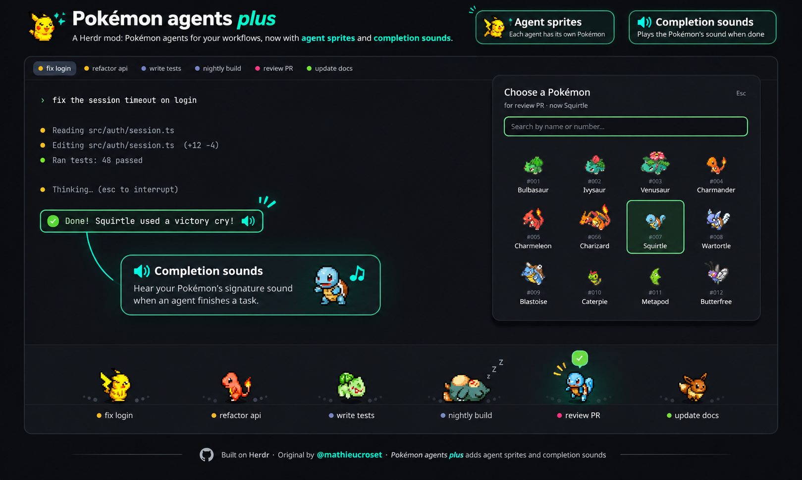
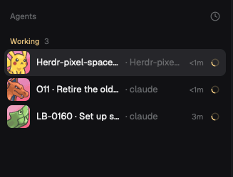
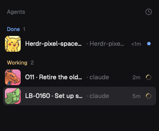

# Pokémon agents plus

Every agent in [Herdr](https://herdr.dev) gets its own Pokémon from the first 151. They wander a
strip along the bottom of the window: working agents walk about, idle ones stroll and nod off, and
one that needs you stops and calls for you. Click a Pokémon to jump to its agent, right-click to
choose which Pokémon it is.

Pokémon agents plus builds on [herdr-pokemon-agents](https://github.com/mathieucroset/herdr-pokemon-agents)
by Mathieu Croset ([mathieucroset](https://github.com/mathieucroset)). The strip, the sprites and the
picker are his work. This version adds two things:

- **Faces in the sidebar.** The agents list shows each agent's Pokémon portrait, and the face
  follows what the agent is doing: determined while it works, worried while it waits on you,
  happy when it's done.
- **Cries.** When an agent needs you, its Pokémon cries. When one finishes while you're looking
  elsewhere, you hear a softer, higher chirp of the same cry. You soon learn who's calling.
  Pikachu and Eevee use their voiced cries ("Pika!", "Vee!") rather than the original 1996 ones.






## Install

Ask your agent: *"add the Herdr mod at github.com/SaifHarding/herdr-pokemon-agents-plus"*. Or by hand:

```sh
cp -r mods/pokemon-agents mods/pokemon-agents-list ~/.config/herdr-app/mods/
herdr-app check ~/.config/herdr-app/mods/pokemon-agents
herdr-app check ~/.config/herdr-app/mods/pokemon-agents-list
```

Then make two changes to your layout. Herdr's own layouts are read-only, so clone one first
(`herdr-app do layout.clone '{"name":"main","as":"my-layout"}'`).

1. Put the strip at the bottom of the main column:
   `{ "type": "block", "content": { "mod": "pokemon-agents" }, "size": { "px": 112 } }`
   ([RECIPE.md](RECIPE.md) shows where).
2. Swap the sidebar's agents list for this one: change `"mod": "agents"` to
   `"mod": "pokemon-agents-list"`.

To hear only the Pokémon, point Herdr's own alert sounds at the silent file that comes with the
mod, in `~/.config/herdr-app/settings.json`:

```json
"sounds": {
  "enabled": true,
  "blocked": "mods/pokemon-agents/silent.mp3",
  "done": "mods/pokemon-agents/silent.mp3"
}
```

Leave that out and you'll hear Herdr's sound and the Pokémon together.

There's an optional key too: merge [keys.json](keys.json) and `alt-shift-p` picks a Pokémon for
the focused agent.

You'll need `curl` and [ImageMagick](https://imagemagick.org) on your PATH, and
[ffmpeg](https://ffmpeg.org) for the done chirp. Without ffmpeg, the full cry plays both times.

## What it downloads

Nothing Pokémon is in this repo. The first time a Pokémon turns up, the mod fetches what it needs
into `~/.config/herdr-app/data/pokemon-agents/` and keeps it there:

- walking sprites and portraits from PMDCollab's SpriteCollab, on raw.githubusercontent.com
- menu icons from PokeAPI's sprites, on raw.githubusercontent.com
- cries, as MP3s, from play.pokemonshowdown.com

It runs `curl`, ImageMagick and ffmpeg on your machine, and sends nothing anywhere.

The cries play only while the strip is in your layout, because the strip is the part that
listens. A layout with just the sidebar list shows the faces but stays quiet.

## Credits

- The original mod, [herdr-pokemon-agents](https://github.com/mathieucroset/herdr-pokemon-agents), is by
  Mathieu Croset ([mathieucroset](https://github.com/mathieucroset)), under MIT.
- Sprites and portraits: [PMD SpriteCollab](https://github.com/PMDCollab/SpriteCollab) by the
  PMDCollab artists, CC BY-NC 4.0 (each sprite's credits are in their repo).
- Menu icons: [PokeAPI/sprites](https://github.com/PokeAPI/sprites).
- Cries: [Pokémon Showdown](https://pokemonshowdown.com)'s audio files.
- `mods/pokemon-agents-list` is Herdr's own agents list with the portraits added. Herdr's mods are
  Apache-2.0; the licence is in that folder.
- Pokémon and all related names are trademarks of Nintendo, Creatures and GAME FREAK. This is an
  unofficial fan mod and isn't affiliated with them.
- `preview.png` is Mathieu's mock-up of the strip, drawn by `tools/make-preview.py`.
  `sidebar.png` and `sidebar-done.png` are screenshots of the agents list.

The code is MIT; see [LICENSE](LICENSE).
